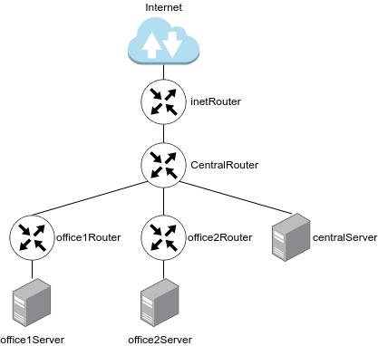

# Теоритическая часть

## Описание

### Архитектура сети:

```
Сеть office1
- 192.168.2.0/26      - dev
- 192.168.2.64/26     - test servers
- 192.168.2.128/26    - managers
- 192.168.2.192/26    - office hardware

Сеть office2
- 192.168.1.0/25      - dev
- 192.168.1.128/26    - test servers
- 192.168.1.192/26    - office hardware

Сеть central
- 192.168.0.0/28     - directors
- 192.168.0.32/28    - office hardware
- 192.168.0.64/26    - wifi

```

**Схема в виде изображения для наглядности:**





**Итого должны получиться следующие сервера:**

- inetRouter
- centralRouter
- office1Router
- office2Router
- centralServer
- office1Server
- office2Server

**В этой части перед нами стоит несколько важных задач которые повлияют на практическую часть:**
- Найти свободные подсети
- Посчитать количество узлов в каждой подсети, включая свободные
- Указать Broadcast-адрес для каждой подсети
- Проверить, нет ли ошибок при разбиении

**Немного общей информации для понимания работы стенда:**

Сеть — очень важная составляющая в работе серверов. По сети сервера взаимодействуют между собой. 

В данном случае мы рассмотрим технологии маршрутизации и NAT.

==Маршрутизация — выбор оптимального пути передачи пакетов. Для маршрутизации используется таблица маршрутизации. 
Основная задача маршрутизации — доставить пакет по указанному IP-адресу. ==
Если одно устройство имеет сразу несколько подсетей, например в сервере есть 2 порта с адресами:
1. 192.168.1.10/24
2. 10.10.12.72/24
то, такие сети называются непосредственно подключенными (Directly connected networks). Маршрутизация между Directly Connected сетями происходит автоматически. 
Дополнительная настройка не требуется. 

Если необходимая сеть удалена, маршрутизатор будет искать через какой порт она будет доступна, если такой порт не найден, то трафик уйдет на шлюз по умолчанию. 

Маршрутизация бывает статическая и динамическая.

При использовании статической маршрутизации администратор сам создает правила для маршрутов. Плюсом данного метода является безопасность, так как статические маршруты не обновляются по сети, а минусом — сложности при работе с сетями больших объёмов…
Динамическая маршрутизация подразумевает автоматическое построение маршрутов с помощью различных протоколов (RIP,OSPF,BGP, и.т.д.). Маршрутизаторы сами обмениваются друг с другом информацией о сетях и автоматически прописывают маршруты.

==NAT — это процесс, используемый для преобразования сетевых адресов. ==

Основные цели NAT:

- Экономия публичных IPv4-адресов 
- Повышение степени конфиденциальности и безопасности сети. 

NAT обычно работает на границе, где локальная сеть соединяется с сетью Интернет. Когда устройству сети потребуется подключение к устройству вне его сети (например в Интернете), пакет пересылается маршрутизатору с NAT, а маршрутизатор преобразовывает его внутренний адрес в публичный.

### Расчет количества сетей и адресов.

Первым шагом мы рассмотрим все сети, указанные в описании данного стенда. Посчитаем для них количество узлов, найдём Broadcast-адрес, проверим, нет ли ошибок при разбиении.

Расчеты можно выполнить вручную, или воспользоваться калькулятором сетей. Для примера, посчитаем одну подсеть вручную:

У нас есть сеть directors 192.168.0.0/28
192.168.0.0 — это сама сеть, 28 — это маска. Маска показывает нам, границы сети 192.168.0.0. Маска может быть записана в 2-х видах: 
1) /28
2) 255.255.255.240

Пример перевода маски /28 в формат 255.255.255.240:

Маска Ipv4-адреса — это 4 октета, т.е. 4 блока по 8 цифр (1 или 0). 
/28 — это 28 единиц с начала маски: 11111111.11111111.11111111.11110000  
Всегда при разбиении сетей, после знака / указывается количество единиц с начала маски.

11111111.11111111.11111111.11110000 — это двоичный код маски, если мы переведем данное значение в десятичную систему счисления, то получим 255.255.255.240

Далее посчитаем количество устройств в сети: 
Количество устройств в сети рассчитывается по формуле = 232−маска−2
Таким образом, количество устройств для подсети /28 будет = 232−28−2=16−2=14

Цифра 2 вычитается, так как:
Первый адрес (192.168.0.0) — это наименование подсети, его нельзя задать устройству
Последний адрес (192.168.0.15) — это всегда broadcast-адрес. Broadcast-адрес нужен для рассылки всем устройствам сети. 

Таким образом мы можем сформировать таблицу топологии нашей сети:
![[Pasted image 20261102230635.png]]

По такому примеру нужно рассчитать остальные сети. Для проверки себя можно использовать калькулятор масок, например, этот - https://ip-calculator.ru/ 

**После расчета всех сетей, мы должны получить следующую таблицу топологии:**

![[Pasted image 20261102230310.png]]

После создания таблицы топологии, мы видим, что ошибок нет, также мы сразу видим следующие свободные сети: 

192.168.0.16/28 
192.168.0.48/28
192.168.0.128/25
192.168.255.64/26
192.168.255.32/27
192.168.255.16/28
192.168.255.8/29  
192.168.255.4/30 

**На этом теоретическая часть заканчивается. Можем приступать к реализации практической части.**

# Практическая часть

Изучив таблицу топологии сети  из информации выше, мы можем построить полную схему сети:

![[Pasted image 20261102230127.png]]

Давайте рассмотрим схему: 
Знак облака означает сеть, которую необходимо будет настроить на сервере
Значки роутеров и серверов означают хосты, которые нам нужно будет создать. 

На схеме, мы сразу можем увидеть, что нам потребуется создать дополнительно 2 сети (на схеме обозначены полужирными фиолетовыми линиями):
Для соединения office1Router c centralRouter 
Для соединения office2Router c centralRouter 

На основании этой схемы мы получаем готовый список серверов.
![[Pasted image 20261102230204.png]]

Все виртуальные машины у нас будут работать на Ubuntu 22.04.

## Конфигурационные файлы 

### `vagrantfile`

```ruby
# -*- mode: ruby -*-
# vi: set ft=ruby :

MACHINES = {
  :inetRouter => {
    :box_name => "ubuntu/jammy64",
    :vm_name => "inetRouter",
    :net => [
      # Адрес для NAT-сети (для Ansible)
      ["192.168.50.10", 2, "255.255.255.0"],
      # Сеть router-net: inetRouter <-> centralRouter
      ["192.168.255.1", 3, "255.255.255.252", "router-net"],
    ]
  },

  :centralRouter => {
    :box_name => "ubuntu/jammy64",
    :vm_name => "centralRouter",
    :net => [
      ["192.168.50.11", 2, "255.255.255.0"],
      ["192.168.255.2", 3, "255.255.255.252", "router-net"],
      # central: directors 192.168.0.0/28
      ["192.168.0.1", 4, "255.255.255.240", "dir-net"],
      # central: office hardware 192.168.0.32/28
      ["192.168.0.33", 5, "255.255.255.240", "hw-net"],
      # central: wifi 192.168.0.64/26
      ["192.168.0.65", 6, "255.255.255.192", "wifi-net"],
      # centralRouter <-> office1Router
      ["192.168.255.9", 7, "255.255.255.252", "central-office1"],
      # centralRouter <-> office2Router
      ["192.168.255.5", 8, "255.255.255.252", "central-office2"],
    ]
  },

  :office1Router => {
    :box_name => "ubuntu/jammy64",
    :vm_name => "office1Router",
    :net => [
      ["192.168.50.20", 2, "255.255.255.0"],
      ["192.168.255.10", 3, "255.255.255.252", "central-office1"],
      # dev 192.168.2.0/26
      ["192.168.2.1", 4, "255.255.255.192", "office1-dev"],
      # test servers 192.168.2.64/26
      ["192.168.2.65", 5, "255.255.255.192", "office1-test"],
      # managers 192.168.2.128/26
      ["192.168.2.129", 6, "255.255.255.192", "office1-managers"],
      # office hardware 192.168.2.192/26
      ["192.168.2.193", 7, "255.255.255.192", "office1-hw"],
    ]
  },

  :office2Router => {
    :box_name => "ubuntu/jammy64",
    :vm_name => "office2Router",
    :net => [
      ["192.168.50.30", 2, "255.255.255.0"],
      ["192.168.255.6", 3, "255.255.255.252", "central-office2"],
      # dev 192.168.1.0/25
      ["192.168.1.1", 4, "255.255.255.128", "office2-dev"],
      # test servers 192.168.1.128/26
      ["192.168.1.129", 5, "255.255.255.192", "office2-test"],
      # office hardware 192.168.1.192/26
      ["192.168.1.193", 6, "255.255.255.192", "office2-hw"],
    ]
  },

  :centralServer => {
    :box_name => "ubuntu/jammy64",
    :vm_name => "centralServer",
    :net => [
      ["192.168.50.12", 2, "255.255.255.0"],
      # directors 192.168.0.0/28
      ["192.168.0.2", 3, "255.255.255.240", "dir-net"],
    ]
  },

  :office1Server => {
    :box_name => "ubuntu/jammy64",
    :vm_name => "office1Server",
    :net => [
      ["192.168.50.21", 2, "255.255.255.0"],
      # managers 192.168.2.128/26
      ["192.168.2.130", 3, "255.255.255.192", "office1-managers"],
    ]
  },

  :office2Server => {
    :box_name => "ubuntu/jammy64",
    :vm_name => "office2Server",
    :net => [
      ["192.168.50.22", 2, "255.255.255.0"],
      # dev 192.168.1.0/25
      ["192.168.1.2", 3, "255.255.255.128", "office2-dev"],
    ]
  },
}

Vagrant.configure("2") do |config|
  MACHINES.each do |boxname, boxconfig|
    config.vm.define boxname do |box|
      box.vm.box = boxconfig[:box_name]
      box.vm.host_name = boxconfig[:vm_name]

      box.vm.provider "virtualbox" do |v|
        v.memory = 1500
        v.cpus = 2
      end

      boxconfig[:net].each do |ipconf|
        box.vm.network(
          "private_network",
          ip: ipconf[0],
          adapter: ipconf[1],
          netmask: ipconf[2],
          virtualbox__intnet: ipconf[3]
        )
      end

      if boxconfig.key?(:public)
        box.vm.network "public_network", boxconfig[:public]
      end

      # Копируем SSH-ключи для root
      box.vm.provision "shell", inline: <<-SHELL
        mkdir -p /root/.ssh
        cp ~vagrant/.ssh/authorized_keys /root/.ssh/
        chmod 600 /root/.ssh/authorized_keys
      SHELL
      # Удаляем ненужный cloud-init файл в `/etc/netplan/`
      box.vm.provision "shell", inline: <<-SHELL
        rm /etc/netplan/50-cloud-init.yaml
      SHELL
      # Создаем отдельный файл с настройкой интерфеса для выхода в интернет
       if boxconfig[:vm_name] == "inetRouter"
       box.vm.provision "shell", inline: <<-SHELL
      # Убедиться, что enp0s3 управляется Netplan и включён DHCP
         cat > /etc/netplan/00-inet-nat.yaml <<'EOF'
network:
  version: 2
  ethernets:
    enp0s3:
      dhcp4: true
      dhcp4-overrides:
        use-routes: true
EOF
    chmod 600 /etc/netplan/00-inet-nat.yaml
    netplan apply
      SHELL
      end
      # Ansible запускается только после создания последней ВМ
      if boxconfig[:vm_name] == "office2Server"
        box.vm.provision "ansible" do |ansible|
          ansible.playbook = "ansible/provision.yml"
          ansible.inventory_path = "ansible/hosts"
          ansible.host_key_checking = "false"
          ansible.limit = "all"
        end
      end
    end
  end
end

```

**Проясним несколько моментов по `vagrantfile`:**
- Каждой машине выделили по 1500 Гб опертивной памяти и по 2 ядра.
```ruby
box.vm.provider "virtualbox" do |v|
        v.memory = 1500
        v.cpus = 2
      end
```

- Пришлось вставить команду удаления стандартного конфигурационного файла netplan. Этот файл иногда перебивал файл 50-vagrant.yaml который мы копировали на хост.
```ruby
# Удаляем ненужный cloud-init файл в `/etc/netplan/`
      box.vm.provision "shell", inline: <<-SHELL
        rm /etc/netplan/50-cloud-init.yaml
      SHELL
```

- Для виртуальной машины `inetRouter` добавили создание конфигурационного файла netplan для интерфейса который смотрит в глобальную сеть.
```ruby
# Создаем отдельный файл с настройкой интерфеса для выхода в интернет
       if boxconfig[:vm_name] == "inetRouter"
       box.vm.provision "shell", inline: <<-SHELL
      # Убедиться, что enp0s3 управляется Netplan и включён DHCP
         cat > /etc/netplan/00-inet-nat.yaml <<'EOF'
network:
  version: 2
  ethernets:
    enp0s3:
      dhcp4: true
      dhcp4-overrides:
        use-routes: true
EOF
    chmod 600 /etc/netplan/00-inet-nat.yaml
    netplan apply
      SHELL
      end
```

```ad-warning
Еще нужно заметить что на все конфигурационные файлы выдем права `600`. Без этого выходят предупреждающие ошибки.
```

- Ansible запускаем только после того как создасться последняя vm.
```ruby
# Ansible запускается только после создания последней ВМ
      if boxconfig[:vm_name] == "office2Server"
        box.vm.provision "ansible" do |ansible|
          ansible.playbook = "ansible/provision.yml"
          ansible.inventory_path = "ansible/hosts"
          ansible.host_key_checking = "false"
          ansible.limit = "all"
        end
```

### `./ansible/hosts`

В этом файле объединили виртуальные машины в группы:

```ruby
[routers]
inetRouter     ansible_host=192.168.50.10 ansible_user=vagrant ansible_ssh_private_key_file=.vagrant/machines/inetRouter/virtualbox/private_key
centralRouter  ansible_host=192.168.50.11 ansible_user=vagrant ansible_ssh_private_key_file=.vagrant/machines/centralRouter/virtualbox/private_key
office1Router  ansible_host=192.168.50.20 ansible_user=vagrant ansible_ssh_private_key_file=.vagrant/machines/office1Router/virtualbox/private_key
office2Router  ansible_host=192.168.50.30 ansible_user=vagrant ansible_ssh_private_key_file=.vagrant/machines/office2Router/virtualbox/private_key

[servers]
centralServer  ansible_host=192.168.50.12 ansible_user=vagrant ansible_ssh_private_key_file=.vagrant/machines/centralServer/virtualbox/private_key
office1Server  ansible_host=192.168.50.21 ansible_user=vagrant ansible_ssh_private_key_file=.vagrant/machines/office1Server/virtualbox/private_key
office2Server  ansible_host=192.168.50.22 ansible_user=vagrant ansible_ssh_private_key_file=.vagrant/machines/office2Server/virtualbox/private_key

[all:vars]
ansible_python_interpreter=/usr/bin/python3

```

### `./ansible/provision.yml`

```ruby
---
# Устанавливаем пакеты которые пригодятся нам в последующем
- name: Base setup for all hosts
  hosts: all
  become: true
  gather_facts: true
  tasks:
    - name: Install useful packages
      apt:
        name:
          - traceroute
          - iptables
          - iptables-persistent
        state: present
        update_cache: true

- name: Setup routers (NAT + forwarding)
  hosts: routers
  become: true
  gather_facts: true
  tasks:
    - name: Enable IPv4 forwarding
      sysctl:
        name: net.ipv4.conf.all.forwarding
        value: '1'
        state: present
        sysctl_set: true
        reload: true

      # Отключаем firewall
    - name: Disable ufw (not needed, using iptables)
      systemd:
        name: ufw
        state: stopped
        enabled: false
      ignore_errors: true

     # Копируем заранее созданный файл с правилами iptables

    - name: Copy iptables rules file (only inetRouter)
      template:
        src: iptables_rules.ipv4
        dest: /etc/iptables_rules.ipv4
        owner: root
        group: root
        mode: "0644"
      when: ansible_hostname == "inetRouter"

    # Создаем сервис для автоматического развертывания правил при загрузке

    - name: Install iptables-restore systemd unit (only inetRouter)
      copy:
        dest: /etc/systemd/system/iptables-restore.service
        mode: "0644"
        content: |
          [Unit]
          Description=Restore iptables rules
          After=network-online.target
          Wants=network-online.target

          [Service]
          Type=oneshot
          ExecStart=/sbin/iptables-restore /etc/iptables_rules.ipv4
          RemainAfterExit=yes

          [Install]
          WantedBy=multi-user.target
      when: ansible_hostname == "inetRouter"

    # Запускаем созданный ранее сервис

    - name: Enable and start iptables-restore.service (only inetRouter)
      systemd:
        name: iptables-restore.service
        enabled: true
        state: started
        daemon_reload: true
      when: ansible_hostname == "inetRouter"
# Эту часть оставил закоментированной на всякий случай. 
# Эта реализация автоматической загрузки правил сходу не сработала.
#    - name: Copy iptables restore script (only inetRouter)
#      template:
#        src: iptables_restore
#        dest: /etc/network/if-pre-up.d/iptables
#        owner: root
#        group: root
#        mode: "0755"
#      when: ansible_hostname == "inetRouter"


      # Вручную применяем правила скопированные ранее
    - name: Apply iptables rules now (only inetRouter)
      shell: iptables-restore < /etc/iptables_rules.ipv4
      when: ansible_hostname == "inetRouter"


# Отключаем дефолтную маршрутизацию через первый адаптер на всех машинах
# Делаем это для того что бы пакеты не выходили в сеть сразу
# через этот интерфейс а проходили по задуманному маршруту 
# и выходили через шлюз inetRouter
- name: Disable default route on eth0 for all except inetRouter
  hosts: all
  become: true
  gather_facts: true
  tasks:
    - name: Disable dhcp routes on eth0
      template:
        src: 00-installer-config.yaml
        dest: /etc/netplan/00-installer-config.yaml
        owner: root
        group: root
        mode: "0600"
      when: ansible_hostname != "inetRouter"


# Раскидываем файлы с заранее прописанными статическими маршрутами.
# Обратим внимание на то что необходимый файл подхватиться в зависимости
# от названия хоста.
- name: Configure static routes (netplan)
  hosts: all
  become: true
  gather_facts: true
  tasks:
    - name: Copy netplan config with routes
      template:
        src: "50-vagrant_{{ ansible_hostname }}.yaml"
        dest: /etc/netplan/50-vagrant.yaml
        owner: root
        group: root
        mode: "0600"

    - name: Apply netplan
      command: netplan apply

    - name: Reboot to verify persistence
      reboot:
        reboot_timeout: 600

```

```ad-warning
Обратим внимание что в этом случае тоже выдаем права `600` на все копируемые конфигурационные файлы касающиеся nrtplan.
```

### Теперь перейдем к файлам которые будут находиться в директории `./ansible/templates/`

Судя по дереву файлов данного стенда их там не малое количество:
```
.
├── ansible
│   ├── hosts
│   ├── provision.yml
│   └── templates
│       ├── 00-installer-config.yaml
│       ├── 50-vagrant_centralRouter.yaml
│       ├── 50-vagrant_centralServer.yaml
│       ├── 50-vagrant_inetRouter.yaml
│       ├── 50-vagrant_office1Router.yaml
│       ├── 50-vagrant_office1Server.yaml
│       ├── 50-vagrant_office2Router.yaml
│       ├── 50-vagrant_office2Server.yaml
│       ├── iptables_restore
│       └── iptables_rules.ipv4
└── vagrantfile

3 directories, 13 files
```

Начнем по описанному выше порядку:

### `./ansible/templates/00-installer-config.yaml`

```yaml
network:
  version: 2
  ethernets:
    enp0s3:
      dhcp4: true
      dhcp4-overrides:
        use-routes: false
      dhcp6: false
```

### `./ansible/templates/50-vagrant_centralRouter.yaml`

```yaml
network:
  version: 2
  ethernets:
    enp0s8:
      addresses:
        - 192.168.50.11/24

    enp0s9:
      addresses:
        - 192.168.255.2/30
      routes:
        - to: default
          via: 192.168.255.1

    enp0s10:
      addresses:
        - 192.168.0.1/28

    enp0s16:
      addresses:
        - 192.168.0.33/28

    enp0s17:
      addresses:
        - 192.168.0.65/26

    enp0s18:
      addresses:
        - 192.168.255.9/30
      routes:
          # маршрут в сети office1 через office1Router
        - to: 192.168.2.0/24
          via: 192.168.255.10

    enp0s19:
      addresses:
        - 192.168.255.5/30
      routes:
          # маршрут в сети office2 через office2Router
        - to: 192.168.1.0/24
          via: 192.168.255.6

```

### `./ansible/templates/50-vagrant_centralServer.yaml`

```yaml
network:
  version: 2
  ethernets:
    enp0s8:
      addresses:
        - 192.168.50.12/24
    enp0s9:
      addresses:
        - 192.168.0.2/28
      routes:
        - to: default
          via: 192.168.0.1
```

### `./ansible/templates/50-vagrant_inetRouter.yaml`

```yaml
network:
  version: 2
  ethernets:
    enp0s8:
      addresses:
        - 192.168.50.10/24
    enp0s9:
      addresses:
        - 192.168.255.1/30
      routes:
        - to: 192.168.0.0/16
          via: 192.168.255.2
        - to: 192.168.1.0/24
          via: 192.168.255.2
        - to: 192.168.2.0/24
          via: 192.168.255.2

```

### `./ansible/templates/50-vagrant_office1Router.yaml`

```yaml
network:
  version: 2
  ethernets:
    enp0s8:
      addresses:
        - 192.168.50.20/24

    enp0s9:
      addresses:
        - 192.168.255.10/30
      routes:
        - to: default
          via: 192.168.255.9
        - to: 192.168.0.0/16
          via: 192.168.255.9
        - to: 192.168.1.0/24
          via: 192.168.255.9

    enp0s10:
      addresses:
        - 192.168.2.1/26

    enp0s16:
      addresses:
        - 192.168.2.65/26

    enp0s17:
      addresses:
        - 192.168.2.129/26

    enp0s18:
      addresses:
        - 192.168.2.193/26
```

### `./ansible/templates/50-vagrant_office1Server.yaml`

```yaml
network:
  version: 2
  ethernets:
    enp0s8:
      addresses:
        - 192.168.50.21/24

    enp0s9:
      addresses:
        - 192.168.2.130/26
      routes:
        - to: default
          via: 192.168.2.129
```

### `./ansible/templates/50-vagrant_office2Router.yaml`

```yaml
network:
  version: 2
  ethernets:
    enp0s8:
      addresses:
        - 192.168.50.30/24

    enp0s9:
      addresses:
        - 192.168.255.6/30
      routes:
        - to: default
          via: 192.168.255.5
        - to: 192.168.0.0/16
          via: 192.168.255.5
        - to: 192.168.2.0/24
          via: 192.168.255.5

    enp0s10:
      addresses:
        - 192.168.1.1/25

    enp0s16:
      addresses:
        - 192.168.1.129/26

    enp0s17:
      addresses:
        - 192.168.1.193/26

```

### `./ansible/templates/50-vagrant_office2Server.yaml`

```yaml
network:
  version: 2
  ethernets:
    enp0s8:
      addresses:
        - 192.168.50.22/24

    enp0s9:
      addresses:
        - 192.168.1.2/25
      routes:
        - to: default
          via: 192.168.1.1
```

### `./ansible/templates/iptables_restore`

Этот файл тоже оставим для примера. В стенде мы в итоге не использовали его.

```bash
#!/bin/sh
/sbin/iptables-restore < /etc/iptables_rules.ipv4
```

### `./ansible/templates/iptables_rules.ipv4`

Файл с правилами iptables.

```bash
*filter
:INPUT ACCEPT [0:0]
:FORWARD ACCEPT [0:0]
:OUTPUT ACCEPT [0:0]
-A INPUT -p icmp -j ACCEPT
-A INPUT -i lo -j ACCEPT
-A INPUT -p tcp -m state --state NEW -m tcp --dport 22 -j ACCEPT
COMMIT

*nat
:PREROUTING ACCEPT [0:0]
:INPUT ACCEPT [0:0]
:OUTPUT ACCEPT [0:0]
:POSTROUTING ACCEPT [0:0]
-A POSTROUTING ! -d 192.168.0.0/16 -o enp0s3 -j MASQUERADE
COMMIT

```

```ad-warning
Обратим внимание на то что здесь указан интерфейс `enp0s3`. Обязательно проверьте название выходного интерфейса на машине `inetRouter`. 
Строчка `-A POSTROUTING ! -d 192.168.0.0/16 -o enp0s3 -j MASQUERADE` нужна для того что бы работал `NAT`.
```

# Готово

Теперь набрав команду `vagrant up` можем запустить стенд и проверить его в работе.

```shell
vagrant up
```

Для проверки залогинимся на один из крайних сервреров и проверим маршрутизацию с помощью `traceroute`

```
vagrant ssh office1Server
```

Проверяем что машина имеет выход в интернет:

```
ping 8.8.8.8
```

Вывод:
```
vagrant@office1Server:~$ ping 8.8.8.8
PING 8.8.8.8 (8.8.8.8) 56(84) bytes of data.
64 bytes from 8.8.8.8: icmp_seq=1 ttl=110 time=43.4 ms
64 bytes from 8.8.8.8: icmp_seq=2 ttl=110 time=45.7 ms
64 bytes from 8.8.8.8: icmp_seq=3 ttl=110 time=44.9 ms
64 bytes from 8.8.8.8: icmp_seq=4 ttl=110 time=43.0 ms
^C
--- 8.8.8.8 ping statistics ---
4 packets transmitted, 4 received, 0% packet loss, time 3125ms
rtt min/avg/max/mdev = 42.951/44.228/45.672/1.115 ms
```

Проверяем с помощью `traceroute` что данный узел выходит в интернет через `inetRouter`

```
traceroute 8.8.8.8
```

Вывод:
```
vagrant@office1Server:~$ traceroute 8.8.8.8
traceroute to 8.8.8.8 (8.8.8.8), 30 hops max, 60 byte packets
 1  _gateway (192.168.2.129)  0.497 ms  0.464 ms  0.454 ms
 2  192.168.255.9 (192.168.255.9)  0.667 ms  0.658 ms  0.634 ms
 3  192.168.255.1 (192.168.255.1)  0.963 ms  1.208 ms  1.633 ms
 4  10.0.2.2 (10.0.2.2)  1.892 ms  1.885 ms  1.962 ms
 5  router.lan (192.168.78.1)  13.764 ms  13.755 ms  13.728 ms
 6  * * *
 7  lag-4-435.bbr01.nn.ertelecom.ru (109.194.184.18)  7.351 ms  6.517 ms  6.470 ms
 8  bbr03.spb.ertelecom.ru (188.234.152.203)  35.181 ms  35.161 ms  35.502 ms
 9  ae16-0.RT.SL.SPB.retn.ru (139.45.238.94)  40.325 ms  40.306 ms  36.367 ms
10  ae6-106.SR.SL.SPB.retn.ru (46.46.189.6)  36.348 ms  36.327 ms  36.308 ms
11  87.245.248.42 (87.245.248.42)  42.555 ms  43.950 ms  43.883 ms
12  * * *
13  * * *
14  dns.google (8.8.8.8)  58.741 ms  58.712 ms  58.686 ms

```

Анализирую первые строки вывода можно увидеть что на пути пакетов именно те роутеры которые мы задумали.

